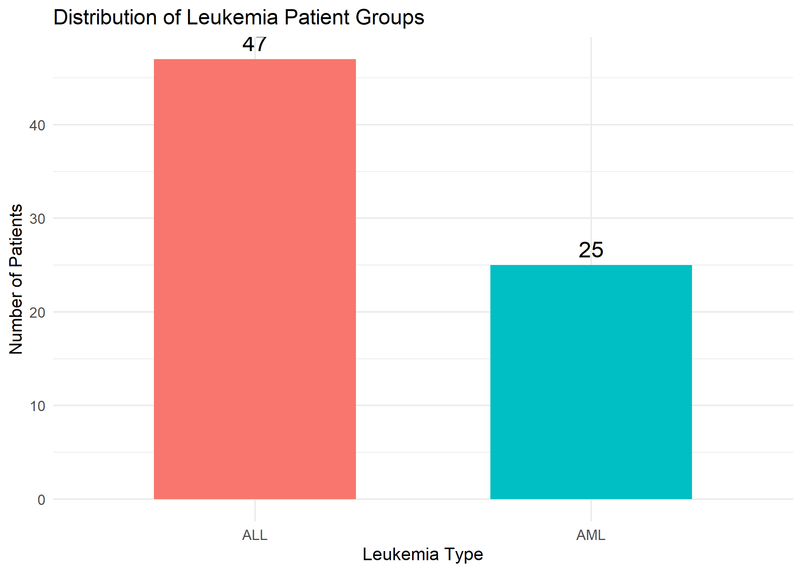
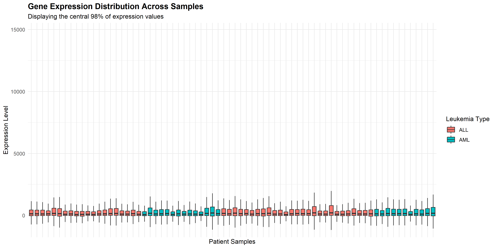
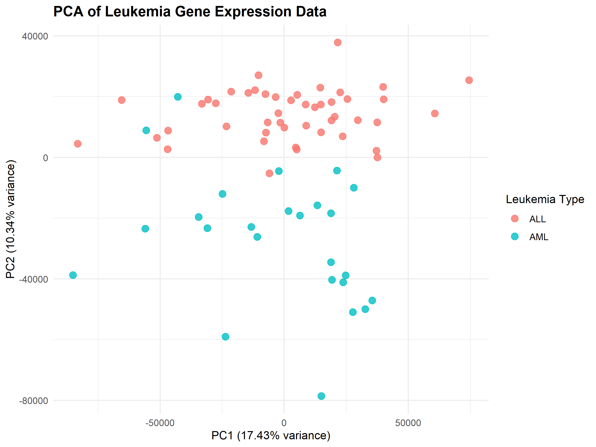
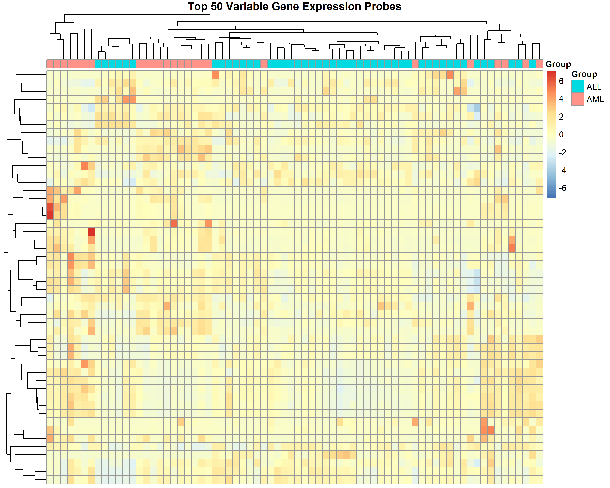
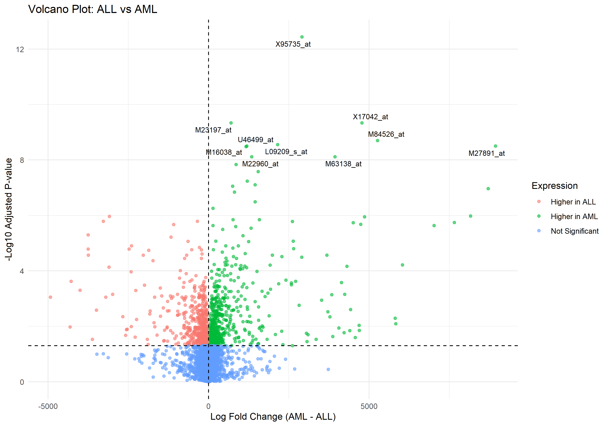
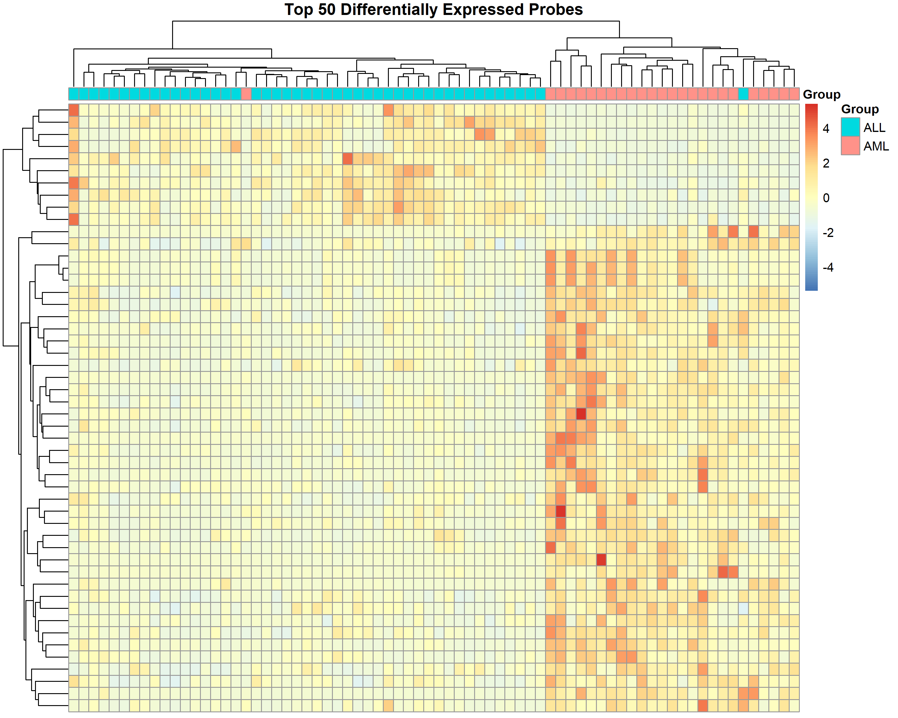

# Leukemia Gene Expression Analysis: ALL vs AML

## 1. Title and Abstract

### Leukemia Gene Expression Analysis: A Comparison of Acute Lymphoblastic Leukemia and Acute Myeloid Leukemia

**Abstract**

Leukemia is a group of blood cancers involving abnormal blood-cell development. Different leukemia subtypes can have distinct gene-expression patterns, making gene-expression analysis useful for studying their molecular differences. This project investigates differences in gene expression between acute lymphoblastic leukemia (ALL) and acute myeloid leukemia (AML) using the publicly available Golub leukemia dataset. The dataset contains 7,129 gene-expression probes from 72 patient samples, including 47 ALL and 25 AML samples. Exploratory data analysis was performed using R, followed by differential-expression analysis using the `limma` package. The Benjamini–Hochberg method was applied to adjust for multiple testing. Using an adjusted p-value below 0.05 and an absolute log-fold change greater than 1, the analysis identified 1,072 significant probes. These findings demonstrate measurable expression differences between the two leukemia groups within this dataset.

---

## 2. Introduction

Leukemia is a type of cancer that affects blood-forming tissues, particularly the bone marrow. It occurs when abnormal blood cells develop and multiply, interfering with the production and normal functioning of healthy blood cells. Leukemia is not a single disease; it includes several subtypes with different biological characteristics.

Two important leukemia subtypes are **acute lymphoblastic leukemia (ALL)** and **acute myeloid leukemia (AML)**. ALL is associated with abnormal development of lymphoid cells, while AML involves abnormal development of myeloid cells. Although both are acute forms of leukemia, they differ in their cellular characteristics and disease biology. Understanding the molecular differences between these subtypes is important for cancer research and the investigation of potential diagnostic and therapeutic approaches.

Gene-expression analysis provides a way to investigate the activity of thousands of genes across biological samples. By comparing gene-expression measurements from different disease groups, researchers can identify genes or gene-expression probes that show differences between the groups. Such differences can provide information about the molecular characteristics associated with each disease subtype.

An important earlier study by Golub et al. (1999) demonstrated the use of gene-expression monitoring to distinguish between acute leukemia classes. The researchers used DNA microarray measurements to investigate molecular classification and prediction of leukemia. Their work established an influential example of applying gene-expression data to cancer classification.

This project uses the publicly available Golub leukemia dataset to conduct a computational comparison of ALL and AML samples. Rather than claiming to discover a new leukemia classification method, the project focuses on carrying out a reproducible gene-expression analysis workflow using R.

### Research Question

**Which gene-expression probes show significant differences between acute lymphoblastic leukemia (ALL) and acute myeloid leukemia (AML) in the Golub leukemia dataset?**

### Aim

The main aim is to identify and explore gene-expression differences between ALL and AML patient samples using statistical analysis and visualization techniques in R.

### Objectives

- Obtain and examine the publicly available Golub leukemia dataset.
- Understand the structure of the gene-expression matrix and associated patient information.
- Explore the distribution of patient samples across ALL and AML groups.
- Visualize gene-expression patterns using statistical plots.
- Perform differential-expression analysis to identify probes that differ between the two groups.
- Apply multiple-testing correction to improve the reliability of statistical findings.
- Present the results through figures, tables, and a reproducible R-based workflow.

---

## 3. Data Description

### 3.1 Dataset Source

This project uses the Golub leukemia dataset provided through the Bioconductor `golubEsets` package. The dataset originates from the work of Golub et al. (1999), which investigated gene-expression patterns in acute leukemia.

The combined dataset is available in R as the `Golub_Merge` expression dataset. It contains the combined training and test samples used in the original study.

Dataset source:

- Bioconductor package: [golubEsets](https://bioconductor.org/packages/release/data/experiment/html/golubEsets.html)
- Original research article: [Golub et al. (1999)](https://doi.org/10.1126/science.286.5439.531)

### 3.2 Dataset Description

The dataset contains gene-expression measurements for **7,129 probes across 72 patient samples**. The samples are divided into two leukemia groups:

| Leukemia group | Number of samples |
|---|---:|
| Acute Lymphoblastic Leukemia (ALL) | 47 |
| Acute Myeloid Leukemia (AML) | 25 |
| **Total** | **72** |

The expression data were measured using Affymetrix HGU6800 microarray chips. The dataset documentation describes the measurements as gene-expression data represented by Affymetrix probes.

The dataset includes two main types of information:

1. **Gene-expression data:** A numerical matrix containing 7,129 probe measurements for each of the 72 patient samples.
2. **Patient information:** Metadata describing the samples, including the leukemia classification and other recorded characteristics.

The patient metadata contains variables such as:

- `Samples`: Original sample identifiers.
- `ALL.AML`: Leukemia classification (ALL or AML).
- `BM.PB`: Sample source, such as bone marrow or peripheral blood.
- `T.B.cell`: Cell classification information for relevant samples.
- `FAB`: French-American-British classification information.
- `Date`: Sample collection date.
- `Gender`: Recorded gender information.
- `pctBlasts`: Estimated percentage of blast cells.
- `Treatment`: Treatment outcome information for relevant AML samples.
- `PS`: Prediction strength information.
- `Source`: Institution associated with the sample.

Some metadata fields contain missing values. These missing metadata values do not automatically mean that the corresponding gene-expression measurements are missing. The expression matrix was checked separately and contained no missing or infinite values.

### 3.3 Ethical and Licensing Considerations

This project uses an existing publicly available dataset rather than collecting new samples or recruiting human participants. The analysis is conducted for academic and educational purposes.

The dataset is distributed through the Bioconductor `golubEsets` package, which identifies its package licence as LGPL. The original dataset's provenance and reuse conditions should be considered separately from the package licence. The dataset documentation should therefore be consulted when redistributing the data or using it for purposes beyond this academic analysis.

No attempt is made in this project to identify individual patients.

---

## 4. Methods

### 4.1 Software and R Packages

The analysis was performed using R and RStudio on Windows.

The following R packages were used:

| Package | Purpose |
|---|---|
| `golubEsets` | Provides the Golub leukemia dataset |
| `Biobase` | Supports the ExpressionSet data structure and extraction of expression and sample information |
| `limma` | Performs differential-expression analysis |
| `ggplot2` | Creates statistical visualizations |
| `dplyr` | Supports data manipulation |
| `tidyr` | Supports data organization and transformation |
| `pheatmap` | Creates clustered heatmaps |
| `ggrepel` | Improves the placement of text labels in plots |
| `knitr` | Supports report generation |
| `rmarkdown` | Generates the HTML report |

### 4.2 Data Loading and Preprocessing

The `Golub_Merge` dataset was loaded from the `golubEsets` package. The expression matrix was extracted using the `exprs()` function, while patient metadata was extracted using `pData()` from the `Biobase` package.

The dimensions of the expression matrix were checked to confirm that it contained 7,129 probes and 72 samples. The patient classification variable was examined to identify the number of ALL and AML samples.

The expression matrix and sample metadata were checked for missing values and infinite values. The expression matrix contained no missing or infinite measurements. Missing values in some metadata fields were not treated as missing gene-expression measurements.

The expression matrix, patient information, and sample-group information were saved into the project's `data/` directory for reuse in later analysis stages.

### 4.3 Exploratory Data Analysis

Exploratory data analysis was performed before differential-expression testing. The purpose was to understand the sample distribution and examine general expression patterns.

The following visualizations were generated:

- **Patient distribution bar chart:** Displays the number of samples belonging to ALL and AML.
- **Expression distribution boxplot:** Compares the distribution of expression measurements across patient samples. The displayed vertical range uses the 1st and 99th percentiles to make the central distributions easier to inspect; this changes the visual display range, not the underlying expression values.
- **Principal Component Analysis (PCA):** Uses the expression matrix to summarize major patterns of variation across samples. PCA was performed on the transposed expression matrix because samples must be represented as observations.
- **Gene-expression heatmap:** Displays the expression patterns of the 50 probes with the highest expression variance across the samples.

These visualizations provide an overview of the dataset. They are exploratory and do not, by themselves, establish that a particular probe is statistically significant or biologically important.

### 4.4 Differential-Expression Analysis

Differential-expression analysis was performed to identify probes with different expression levels between ALL and AML.

The `limma` package was selected because it provides statistical methods for analysing gene-expression data, including microarray experiments. The analysis used the expression matrix and the corresponding patient-group information.

The sample order in the expression matrix was checked against the sample order in the patient-group information to ensure that each expression profile was associated with the correct leukemia classification.

The patient groups were defined as ALL and AML. A design matrix was then created to represent the two groups. The comparison was specified as:

**AML − ALL**

This comparison determines the direction of the estimated expression difference:

- A positive log-fold change indicates higher expression in AML compared with ALL.
- A negative log-fold change indicates higher expression in ALL compared with AML.

The `lmFit()` function was used to fit the linear models. The `makeContrasts()` and `contrasts.fit()` functions were used to define and apply the AML-versus-ALL comparison. The `eBayes()` function was then applied to calculate moderated statistical results.

### 4.5 Multiple-Testing Correction and Significance Criteria

Because thousands of probes were tested, multiple-testing correction was necessary. Testing many probes increases the possibility of obtaining statistically significant results by chance.

The Benjamini–Hochberg (BH) method was used to adjust the p-values and control the false discovery rate.

A probe was classified as significantly differentially expressed when it satisfied both of the following criteria:

- Adjusted p-value (`adj.P.Val`) less than 0.05.
- Absolute log-fold change (`|logFC|`) greater than 1.

The two criteria were applied together to identify probes with statistically significant and comparatively substantial expression differences.

The complete differential-expression results and the filtered significant-probe results were exported as CSV files in the `results/tables/` directory.

### 4.6 Differential-Expression Visualizations

A volcano plot was generated to display the relationship between log-fold change and adjusted statistical significance. The plot highlights probes that meet the selected significance criteria.

A second heatmap was created using the top 50 probes from the significant-probe results. The heatmap was scaled by row to make relative expression patterns easier to compare across samples. Sample-group annotations were included to distinguish ALL and AML samples.

---

## 5. Results

### 5.1 Distribution of Patient Samples

The dataset contains 72 patient samples: 47 ALL samples and 25 AML samples. Therefore, the ALL group is larger than the AML group.



*Figure 1. Distribution of patient samples between acute lymphoblastic leukemia (ALL) and acute myeloid leukemia (AML).*

### 5.2 Expression Distribution

The expression distribution boxplot was used to inspect the overall distribution of expression measurements across the patient samples. The plot provides a visual comparison of the central expression distributions and their spread.



*Figure 2. Distribution of gene-expression measurements across the 72 patient samples.*

### 5.3 Principal Component Analysis

PCA was performed to summarize variation in the gene-expression profiles across samples. Each point represents a patient sample, and the points are grouped according to the recorded leukemia classification.



*Figure 3. Principal Component Analysis (PCA) of the patient gene-expression profiles, with samples grouped by leukemia type.*

The PCA plot provides an exploratory view of similarities and differences among the samples. It should not be interpreted as a formal classification test or as proof that the two leukemia groups can be perfectly separated.

### 5.4 Exploratory Gene-Expression Heatmap

A heatmap was created using the 50 probes with the highest expression variance. This visualization provides an overview of variation in expression patterns across the patient samples.



*Figure 4. Heatmap of the 50 probes with the highest expression variance across the patient samples.*

### 5.5 Differential-Expression Analysis

The differential-expression analysis compared AML samples against ALL samples using the `limma` workflow. The Benjamini–Hochberg adjusted p-values and log-fold changes were used to filter the results.

A total of **1,072 probes** met both significance criteria:

- Adjusted p-value below 0.05.
- Absolute log-fold change greater than 1.

The significant probes were divided according to the direction of their log-fold changes.

| Result category | Number of probes |
|---|---:|
| Higher expression in AML (`logFC > 1`) | 531 |
| Higher expression in ALL (`logFC < -1`) | 541 |
| **Total significant probes** | **1,072** |

The results show that 531 significant probes had higher expression in AML, while 541 significant probes had higher expression in ALL, according to the AML-versus-ALL comparison.

These values refer to expression probes. They should not be interpreted as 1,072 confirmed unique genes because multiple probes may correspond to the same gene, and probe-to-gene annotation was not performed as part of this analysis.

### 5.6 Volcano Plot

The volcano plot presents the differential-expression results using log-fold change and the negative logarithm of the adjusted p-value. It helps visualize the probes that show both larger expression differences and stronger statistical evidence.



*Figure 5. Volcano plot showing differential-expression results for the AML-versus-ALL comparison.*

### 5.7 Heatmap of Significant Probes

A second heatmap was generated using the top 50 probes from the significant-probe results. The expression values were scaled by row, and the sample groups were displayed as column annotations.



*Figure 6. Heatmap showing the expression patterns of the top 50 significant probes across ALL and AML samples.*

### 5.8 Summary of Main Findings

The main result is that 1,072 probes met the selected differential-expression criteria. The results include probes with higher expression in both leukemia groups.

The findings provide evidence of differences in gene-expression measurements between the ALL and AML samples in this dataset. However, statistical significance alone does not establish the biological function of a probe or its usefulness as a diagnostic marker.

The complete statistical results are available in:

- `results/tables/differential_expression_all.csv`
- `results/tables/significant_probes.csv`

---

## 6. Discussion

This project investigated gene-expression differences between acute lymphoblastic leukemia and acute myeloid leukemia using the Golub leukemia dataset. The analysis identified 1,072 significant probes using an adjusted p-value threshold of 0.05 and an absolute log-fold change threshold greater than 1.

The results indicate that the two leukemia groups have different expression measurements for a number of probes in the dataset. Of the significant probes, 531 showed higher expression in AML, while 541 showed higher expression in ALL. The presence of probes with differences in both directions demonstrates that the observed expression changes are not limited to one leukemia group.

The exploratory visualizations provided different perspectives on the data. The patient distribution chart showed that the dataset contains more ALL samples than AML samples. The expression distribution boxplot allowed the overall expression measurements to be inspected. PCA summarized the main variation among samples, while the heatmaps displayed expression patterns across the patient groups. The volcano plot provided a visual summary of the differential-expression results.

The use of `limma` was appropriate for this microarray gene-expression analysis. Its empirical Bayes approach moderates variance estimates, and the Benjamini–Hochberg correction addresses the multiple-testing problem associated with analysing thousands of probes. Applying both an adjusted p-value threshold and a log-fold change threshold helped focus the results on probes with statistical evidence and a minimum expression difference.

### 6.1 Limitations

Several limitations should be considered when interpreting the findings.

First, the analysis uses a dataset containing only 72 samples. Although the dataset includes both leukemia groups, the sample sizes are relatively limited, and the group sizes are unequal. This may affect the generalizability of the findings to larger or different patient populations.

Second, the analysis uses an existing microarray dataset. Microarray measurements represent probe-level expression signals and are not identical to direct measurements of every individual gene. Therefore, the 1,072 significant results should be described as significant probes rather than 1,072 unique genes.

Third, probe annotation and functional enrichment analysis were not included in the current workflow. As a result, the project does not establish the biological functions, pathways, or mechanisms associated with the significant probes. Further annotation would be required before drawing gene-specific biological conclusions.

Fourth, the analysis focuses on the comparison between ALL and AML. Other patient characteristics included in the dataset, such as sample source, gender, and additional clinical metadata, were not incorporated as adjustment variables in the differential-expression model. These characteristics could be investigated in future analyses.

Finally, the results are based on one dataset and one selected set of statistical thresholds. Independent datasets and additional validation methods would be needed to determine whether the findings are reproducible in other patient populations.

### 6.2 Real-World Implications

Identifying gene-expression differences between leukemia subtypes can contribute to research into the molecular characteristics of cancer. Computational analysis of gene-expression data can help researchers prioritize probes for further investigation and develop hypotheses about biological differences between disease groups.

However, the results of this project are exploratory research findings. They should not be used directly for patient diagnosis, treatment selection, or clinical decision-making. Additional biological interpretation, independent validation, and clinical research would be required before any clinical application could be considered.

---

## 7. Conclusion and Future Work

This project successfully conducted a gene-expression analysis comparing acute lymphoblastic leukemia (ALL) and acute myeloid leukemia (AML) using the Golub leukemia dataset. The dataset contained 7,129 probes measured across 72 patient samples, including 47 ALL and 25 AML samples.

The analysis included data loading, preprocessing checks, exploratory data analysis, PCA, heatmap visualization, and differential-expression testing using the `limma` package. Multiple-testing correction was performed using the Benjamini–Hochberg method.

Using an adjusted p-value below 0.05 and an absolute log-fold change greater than 1, the analysis identified 1,072 significant probes. Among them, 531 showed higher expression in AML and 541 showed higher expression in ALL.

The project demonstrates how R and bioinformatics packages can be used to analyse microarray gene-expression data and investigate differences between disease groups. It also provides a reproducible workflow with saved data, analysis scripts, result tables, and visualizations.

### Future Work

The following improvements could extend this project:

1. **Probe annotation:** Map significant Affymetrix probes to gene identifiers and gene symbols to support gene-level interpretation.
2. **Functional enrichment analysis:** Investigate biological processes and pathways associated with annotated significant genes.
3. **Additional statistical analysis:** Explore the influence of available clinical and sample-related variables.
4. **Independent validation:** Repeat the analysis using an independent leukemia gene-expression dataset to investigate the reproducibility of the findings.
5. **Classification analysis:** Investigate whether selected expression features can be used to build and evaluate a predictive model for distinguishing ALL and AML samples.

These improvements could provide a deeper understanding of the biological meaning and potential relevance of the identified expression differences.

---

## 8. Reproducibility

### 8.1 Project Structure

The repository is organized as follows:

```text
Leukemia_Gene_Expression_Analysis/
│
├── code/
│   ├── 01_load_data.R
│   ├── 02_data_preprocessing.R
│   ├── 03_exploratory_analysis.R
│   └── 04_differential_expression.R
│
├── data/
│   ├── expression_data.rds
│   ├── sample_information.csv
│   └── patient_groups.csv
│
├── results/
│   ├── figures/
│   │   ├── patient_distribution.png
│   │   ├── expression_distribution.png
│   │   ├── pca_plot.png
│   │   ├── gene_expression_heatmap.png
│   │   ├── volcano_plot.png
│   │   └── differential_expression_heatmap.png
│   │
│   └── tables/
│       ├── differential_expression_all.csv
│       └── significant_probes.csv
│
├── report/
│   ├── Leukemia_Analysis_Report.Rmd
│   └── Leukemia_Analysis_Report.html
│
├── .gitignore
├── Leukemia_Gene_Expression_Analysis.Rproj
└── README.md
```

### 8.2 Requirements

The project was developed using:

- R version 4.6.2.
- RStudio.
- The R packages listed in Section 4.1.

The exact installed package versions can be checked in the local R environment using `packageVersion()` or `sessionInfo()`.

### 8.3 Installing Required Packages

Install the required CRAN packages using:

```r
install.packages(c(
  "ggplot2",
  "dplyr",
  "tidyr",
  "pheatmap",
  "ggrepel",
  "knitr",
  "rmarkdown"
))
```

Install the Bioconductor packages using:

```r
if (!requireNamespace("BiocManager", quietly = TRUE)) {
  install.packages("BiocManager")
}

BiocManager::install(c(
  "golubEsets",
  "Biobase",
  "limma"
))
```

### 8.4 Running the Analysis

1. Clone or download this GitHub repository.
2. Open `Leukemia_Gene_Expression_Analysis.Rproj` in RStudio.
3. Ensure that the required R packages are installed.
4. Run the scripts in the `code/` directory in numerical order.
5. Check the generated figures in `results/figures/`.
6. Check the differential-expression CSV files in `results/tables/`.
7. Open `report/Leukemia_Analysis_Report.Rmd` in RStudio and use **Knit** to regenerate the HTML report.

The scripts should be run in the project directory so that the relative file paths used for reading and saving data work correctly.

### 8.5 Reproducibility Notes

The analysis uses the `Golub_Merge` dataset provided by `golubEsets`. The processed expression matrix and sample metadata are saved in the repository to support subsequent analysis stages.

The differential-expression results depend on the selected group comparison and filtering criteria. To reproduce the reported significant-probe count, use the AML-versus-ALL contrast and the same filtering criteria:

```r
adj.P.Val < 0.05 & abs(logFC) > 1
```

The project scripts, processed data files, result tables, and figures are included in the repository to make the workflow easier to inspect and reproduce.

---

## 9. References

1. Golub, T. R., Slonim, D. K., Tamayo, P., Huard, C., Gaasenbeek, M., Mesirov, J. P., Coller, H., Loh, M. L., Downing, J. R., Caligiuri, M. A., Bloomfield, C. D., & Lander, E. S. (1999). Molecular classification of cancer: Class discovery and class prediction by gene expression monitoring. *Science, 286*(5439), 531–537. https://doi.org/10.1126/science.286.5439.531

2. Ritchie, M. E., Phipson, B., Wu, D., Hu, Y., Law, C. W., Shi, W., & Smyth, G. K. (2015). limma powers differential expression analyses for RNA-sequencing and microarray studies. *Nucleic Acids Research, 43*(7), e47. https://doi.org/10.1093/nar/gkv007

3. Bioconductor. (n.d.). *golubEsets: exprSets for Golub leukemia data*. https://bioconductor.org/packages/release/data/experiment/html/golubEsets.html

4. R Core Team. (2026). *R: A language and environment for statistical computing*. R Foundation for Statistical Computing, Vienna, Austria. https://www.r-project.org/

5. Wickham, H. (2016). *ggplot2: Elegant graphics for data analysis*. Springer. https://ggplot2-book.org/
