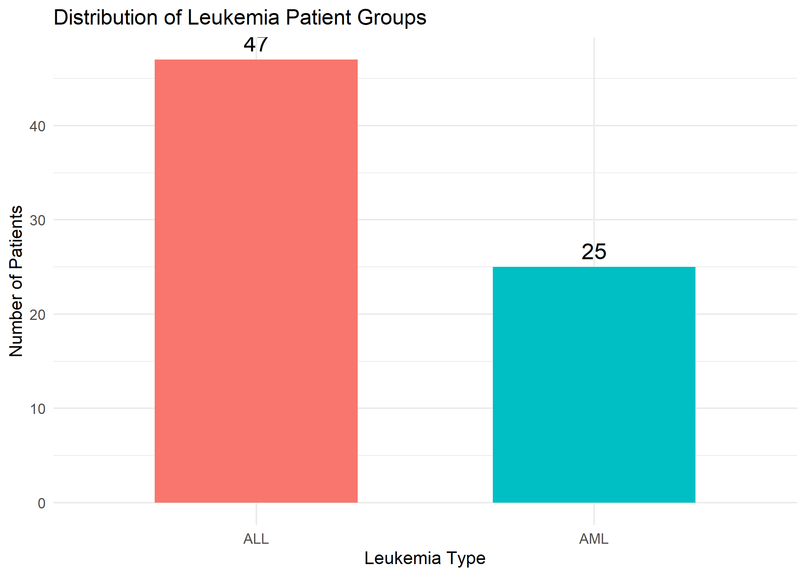
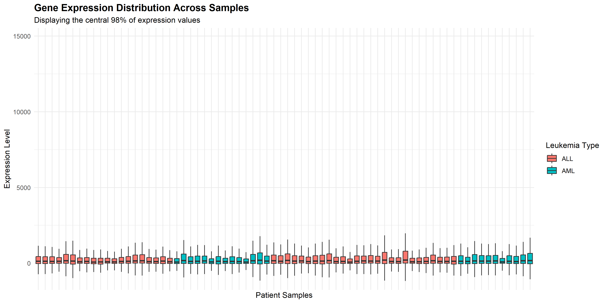
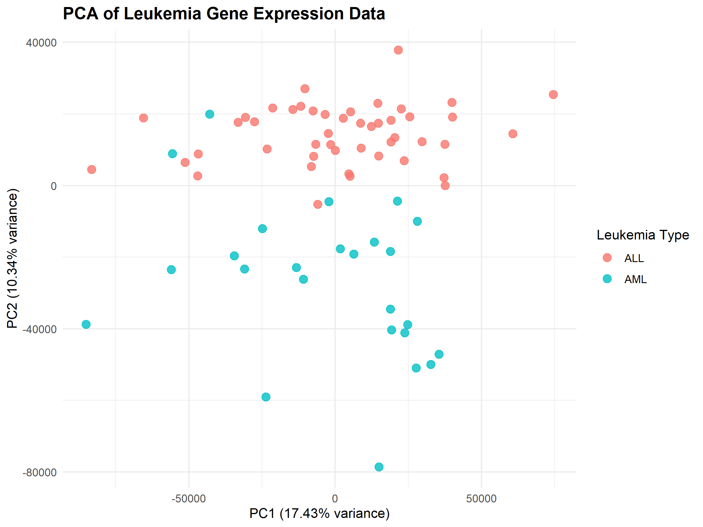
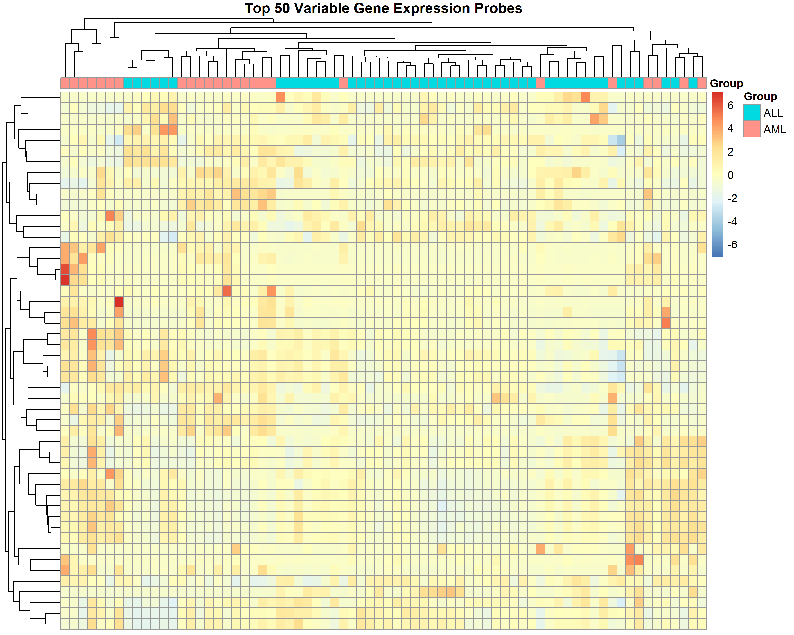
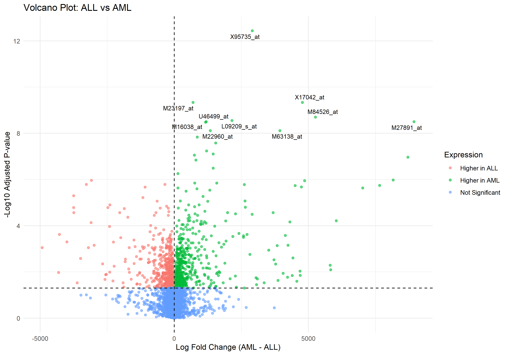
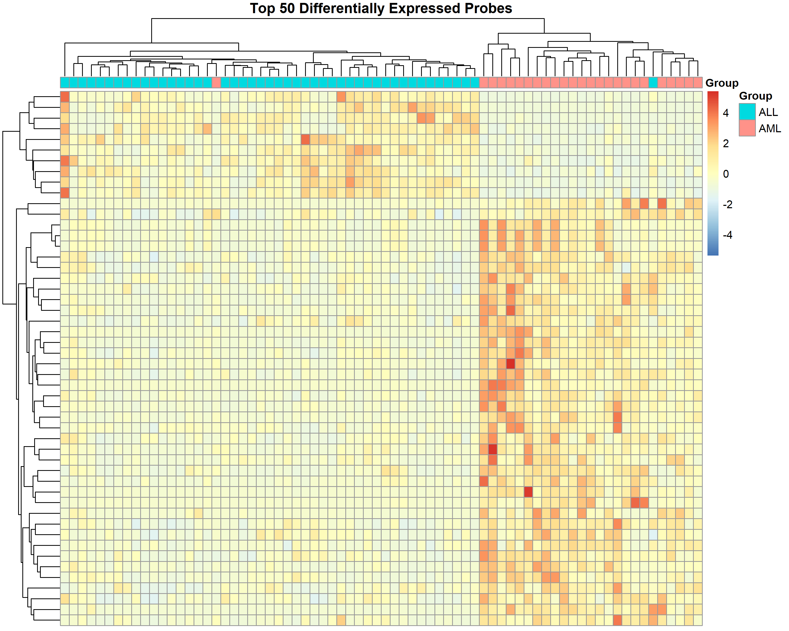

# Introduction

Leukemia is a type of cancer that affects blood-forming tissues, including the bone marrow. Acute Lymphoblastic Leukemia (ALL) and Acute Myeloid Leukemia (AML) are two major types of acute leukemia. Although both conditions affect blood cells, they differ in their biological characteristics.

Gene expression analysis is an important bioinformatics approach used to investigate differences in gene activity between biological conditions. By comparing gene expression profiles, researchers can identify probes that show different expression patterns between disease groups.

This project analyzes a publicly available leukemia gene expression dataset to identify expression differences between ALL and AML patient samples using the R programming language.

# Research Question

Which gene-expression probes show statistically significant differences between Acute Lymphoblastic Leukemia (ALL) and Acute Myeloid Leukemia (AML) patients?

# Project Objectives

- Obtain and examine a publicly available leukemia gene expression dataset.
- Explore the expression patterns of ALL and AML patient samples.
- Perform exploratory data analysis and visualization.
- Identify differentially expressed probes using the limma package.
- Visualize differential expression results using volcano plots and heatmaps.

# Dataset Description

This project uses the Golub leukemia dataset available through the Bioconductor `golubEsets` package.

The dataset contains gene expression measurements from 72 patient samples and 7,129 expression probes.

| Dataset characteristic | Number |
|---|---:|
| Total expression probes | 7,129 |
| Total patient samples | 72 |
| ALL samples | 47 |
| AML samples | 25 |

The expression matrix contains probe-level measurements, while the associated patient information identifies the leukemia group for each sample.

# Tools and Technologies

The analysis was conducted using:

- **R:** Statistical programming and bioinformatics analysis.
- **RStudio:** Development environment.
- **Bioconductor:** Access to biological datasets and analysis packages.
- **limma:** Differential expression analysis.
- **ggplot2:** Data visualization.
- **pheatmap:** Heatmap generation.
- **ggrepel:** Improved plot labeling.

# Methodology

## Data Loading and Preprocessing

The Golub dataset was loaded using the `golubEsets` package. The expression matrix and patient information were extracted using the `Biobase` package.

The dataset was examined to identify missing and infinite expression values. Patient groups were classified into ALL and AML.

The expression matrix contained 7,129 probes and 72 patient samples. The patient groups consisted of 47 ALL samples and 25 AML samples.

The processed expression data and patient information were saved for subsequent analysis.

## Exploratory Data Analysis

Exploratory data analysis was performed to understand the dataset and examine expression patterns.

The following visualizations were generated:

- Patient distribution bar chart.
- Gene expression distribution boxplot.
- Principal Component Analysis (PCA) plot.
- Gene expression heatmap.

PCA was used to examine similarities and differences between patient samples based on their expression profiles.

## Differential Expression Analysis

Differential expression analysis was performed using the `limma` package.

A linear model was fitted for each expression probe using the patient group design matrix.

The comparison was defined as:

`AML - ALL`

Empirical Bayes moderation was applied to improve the statistical estimates.

The Benjamini-Hochberg method was used to adjust p-values for multiple hypothesis testing.

The following criteria were used to identify significantly differentially expressed probes:

- Adjusted p-value (adj.P.Val) < 0.05
- Absolute log fold change (|logFC|) > 1

A positive log fold change indicates higher expression in AML, while a negative log fold change indicates higher expression in ALL.

# Results
## Patient Distribution

## Gene Expression Distribution

## Principal Component Analysis

## Exploratory Gene Expression Heatmap

## Volcano Plot

## Differential Expression Heatmap

## Differential Expression Results

The analysis identified 1,072 probes that satisfied both differential expression criteria.

| Result category | Number of probes |
|---|---:|
| Total significant probes | 1,072 |
| Higher expression in AML | 531 |
| Higher expression in ALL | 541 |

Among the significant probes, 531 showed higher expression in AML samples, while 541 showed higher expression in ALL samples.

These findings indicate differences in gene expression profiles between the two leukemia groups.

The identified results represent expression probes. They should not be interpreted as 1,072 unique genes because probe annotation and mapping are required to establish gene identities.

## Volcano Plot

The volcano plot displays the relationship between log fold change and the negative logarithm of the adjusted p-value.

Probes with higher expression in AML appear on the positive side of the horizontal axis, while probes with higher expression in ALL appear on the negative side.

The plot helps identify probes with both statistically significant and biologically substantial expression differences.

## Differential Expression Heatmap

A heatmap was generated using the 50 most statistically significant probes.

The heatmap displays relative expression patterns across the 72 patient samples. Row scaling was applied to make expression patterns comparable across probes.

Hierarchical clustering was used to group probes and patient samples based on expression similarity.

# Discussion

The analysis identified substantial differences in expression profiles between ALL and AML patient samples.

A total of 1,072 probes met the selected statistical significance and fold-change criteria. The results included 531 probes with higher expression in AML and 541 probes with higher expression in ALL.

The volcano plot provides a visual summary of the statistical significance and magnitude of expression differences. The heatmap provides an additional view of expression patterns across patient samples.

However, the analysis has limitations. The dataset contains only 72 patient samples, and the results are based on microarray expression probes rather than confirmed unique genes. Further probe annotation and independent validation would be necessary before making stronger biological conclusions.

# Conclusion

This project demonstrates the application of bioinformatics techniques to investigate gene expression differences between Acute Lymphoblastic Leukemia and Acute Myeloid Leukemia.

Using the Golub leukemia dataset and the limma statistical framework, 1,072 probes were identified as significantly differentially expressed according to the selected criteria.

The results demonstrate how statistical analysis and visualization can support the investigation of molecular differences between leukemia subtypes.

# References

1. Golub, T. R., et al. (1999). Molecular classification of cancer: Class discovery and class prediction by gene expression monitoring. *Science*, 286(5439), 531–537.
2. Ritchie, M. E., et al. (2015). limma powers differential expression analyses for RNA-sequencing and microarray studies. *Nucleic Acids Research*, 43(7), e47.
3. Bioconductor. `golubEsets` package documentation.
4. Bioconductor. `limma` package documentation.